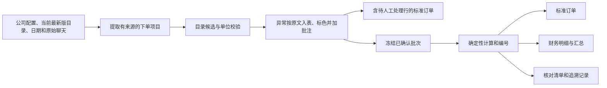

# order-mapping 设计方案

## V7-10：前置、后置及同句属性要求

在V7-9结构上增加“基础名的属性款”“要属性的基础名”“基础名，要求属性与下单数量同句”。只移除完整结构中的语法连接，全部基础名、属性、品牌与未知词仍由同一当前目录记录证明，否定及加工动作不适用自动归一。逗号后的显式要求与前项组成完整事件；原始片段尚无下单量时，可从该要求末尾读取明确下单量，已有量时不得由规格量覆盖。前置数量加尾部要求保留前量。无数量/单位不补造，多种商品解释转人工。新语法以陌生商品正反例、三seed独立冻结原文、旧种子回归验证，首次保留结果单独保存。

## V7-9：有约束的关系表达

共享表达允许将“基础品名要/按属性”“属性品种/等级/产地/形态＋品名”归一为当前目录明确支持的同一商品。连接词只能在完整关系结构中消除；基础品名、全部属性词必须逐段保留并由同一当前目录记录证实。不得任意排序字符、删除未知词、否定词、品牌、加工动作或包装量，不以部分子串证明等价。加工动作与现成商品形态区分，未证加工及计价时保留身份和原量，金额为空。结构证据及边界随共享知识交付，目录更新重新计算，无旧SKU/价格绑定。

评分按实际自动输出统计A；所有冻结输入（包括控制、异常、缺失）保留B分母；额外输出计入A且判错，但不扩大全量输入分母。初始/追加事件只有独立原文数量、单位、同目录名称规格价格及金额预期充分才可判自动正确。缺评测依据不得自证。C需完整独立异常语义依据，unknown维持未验证。

## V7-8 增量：共享受限表达与独立验收

沿用用户持续授权。生产入口为 `knowledge.py`、`expressions.py`、`parsing.py` 和 `knowledge/procurement.json`。知识及规则证据随skill分发，新增概念审阅见 `references/kb16-reviewed-concepts.md`；目录行号只定位证据，不能作为选择依据。跨属性规范化同词配置必须拒绝加载；不全局移动单字“干/鲜”。公司无冒号标题作为文本上下文，“商品，数量未定”保持一个事件，原文跨度完整。

验收A以**实际自动完成事件**为分母；B为自动完成且全字段正确事件数 / 全部冻结事件，review/control即使正确转人工也不计入B；业务处理正确率C另行统计。不得用预期自动数替代A分母。review被误自动须算自动错误。初始/追加/改量/取消逐条保留，活动数量及前驱另外审计，不能预先排除控制项来美化指标。新保留集先冻结，再从普通input进行三模式执行；旧保留消费后标为回归。输出与状态落在V7-8逐项审计、订单和财务草稿；所有指标、原件SHA、候选、原生批注、空金额及合并财务均复读。整体状态doing，局部正常子集通过不关闭全量95%目标。主路径仅新增本地规则/解析，未增加外部调用。

## v7增量：指定品牌的核对参考

指定“某品牌”但当前目录未证明品牌时，不得自动选品；当前目录存在去除显式“牌”前缀后与基础商品名称完全一致、且未标其他已知品牌的记录时，应作为“品牌未证、仅供核对”的参考候选展示。参考检索不得把粉/粒、部位、形态或包装差异当作同义，也不产生计价数量或金额。该规则不依赖公司名称或逐项历史答案，目录变化后重新检索。普通鲜尖椒未限定产地时，同500g的普通尖椒和地产尖椒属于当前已审适配层，以最高现价优先；红色或其他品种限制另行过滤。

## v7增量：泛称适配与异常候选审查

候选检索层与自动选择层分别审计缺失名称；目录名称明示单包装净含量与计价规格冲突时禁止自动选择及包装换算。需求规格同时识别中文质量/体积单位并按等量值比较；没有“要”等触发词的附加品种、规格也须保留。加工需求独立保留身份，未证履约及价格不进入自动金额。新增同类候选保护对同规则别名作受类目约束的检索，不能仅用当前输入词面。原文解析在分割前保护当前目录完整名称与括号；商品数量间冒号是分隔符，明确说明行有单独识别边界。

共享知识将泛称需求、同义名称和替代关系分别建模。泛称自动选择须限定已审查的商品概念，先满足原文明确的品牌、品种、加工、鲜冻、规格和包装要求，再在最接近需求且同计价基础的候选层比较当前挂牌价；不得将所有子品种固化为同义词。候选检索和自动选择可使用不同范围，完整合理候选保留在异常批注中。仅数量单位关系未知时可保留已确定商品身份，金额保持空值。

审阅结论及依据随知识交付；目录更新重新查找名称、属性、规格及价格。新裁定必须另行版本化，既有冻结成绩不回写。v7执行与评测契约在evaluation/v7/audit_contract.md；此前已消费的样本继续视为开发回归。主路径仅新增本地知识筛选，不引入外部调用或重复解析目录的慢点。

## v6当前增量：共享采购知识与独立验证（doing）

2026-11-08按用户最新授权推进。正常识别以随skill发布的共享采购知识为默认，公司主要用于订单归属；有明确证据的特殊约定单独叠加。逐条审查旧公司profile，分为通用、有条件、一次调整及冲突，不直接拼接历史SKU答案。知识关联稳定概念/属性和当前目录，目录更新重新解析候选及价格。新增原文`run-messages`入口，评测答案、来源事件ID及历史逐项决策不进入运行端。

本轮契约见[evaluation/v6/acceptance_contract.md](evaluation/v6/acceptance_contract.md)。验收采用A自动输出正确率、B全量自动正确覆盖率、C全量业务处理正确率，并同时披露全量历史159/155/132分母。历史变形和目录新概念挑战分开，开发/最终保留样本先冻结再执行，种子与样本角色以契约为准。比较仅目录/共享知识/共享加明确公司约定。脚本、Agent语义、宿主兼容及真实订单证据分别报告；v5的历史SKU一致率不继承为v6达标结论。

共享规则自动适用条件和候选检索分开：单位未满足时仍可检索同义概念，不能补造包装关系；有条件的候选扩展只在指定单位上下文生效。商品名、数量后的备注和原文明确状态共同约束品牌、鲜冻/熟制、加工及规格。未证实要求不得计价。品牌未注明的目录项可作为带理由的待核参考，不等同指定品牌。候选逐项理由和未知项原文进入Excel原生批注。

解析器使用当前目录及正式知识名称作为词法边界，不读取评测ID、人工行或历史答案。数字规格如80*100须与紧随其后的需求数量分开；紧邻的前置数量商品也单独保留。零、负、非法、范围和备选数量逐条待核；明确总量更改关联全部已知前项，取消/重发保留控制状态。知识、解析状态及事件前驱写入台账，订单和财务只从同一台账导出。该词表由当前版本一次读取，不新增外部主路径调用。

状态：2026-11-07用户已授权建立目标并推进实施、使用original业务场景全面验证和交付。设计包含异常原文入表标色批注、价目表最新版管理两项补充。本文是本专题唯一主设计文档。样例事实见 [业务样例核对.md](业务样例核对.md)，落地步骤见 [task_plan.md](task_plan.md)，准入和验收状态见 [执行清单.md](执行清单.md)。

V6-9：共享普通需求不能仅因未指定品牌或目录附加描述而全部转人工。普通整品优先于切丝/加厚等额外形态，在符合原文且同计价基础的候选中比较当前价。新增概念选择仍限定已审阅的稳定名称和单位，不扩张为任意模糊词自动选择；知识规则的证据和反例随包交付。

V6-10/11：普通前缀仅在已审概念内作为表达变体；合法XLSX缺工作表dimension时按流式迭代读取目录，不修改源表。普通下五花肉、木耳、红肠、粉肠按原文最接近层与同计价基础当前价择优；明确品牌/下五花/小木耳/去皮/切片等在数量后备注也必须保留。静态审阅、首轮失败、修复和同冻结回归分别保存，禁止修改原预期抬分。

V6-12/13：共享规则条件支持notes_excludes，与notes_contains共同检查原文/备注；明确去皮下五花动态取当前同部位去皮项，未要求去皮不强加。不要去皮/不去皮/带皮在目录无带皮正证据时待核，不误触发去皮。此边界仅覆盖已实现表达，不能证明完整否定语义。

V6-14：加工备注的否定与订单取消分开处理。“不要去皮”不能单凭“不要”生成取消提示，备注外或另外明确的取消仍保留。北极冰虾80*100在当前目录具有唯一同品种同数字规格项；原文未限定鲜活时，不将目录附加“冷冻”视为冲突。条件规则必须执行鲜活、非冷冻、品牌及规格反例约束；不把80*100当作袋重。目录计价基础变更后重新换算，未知包装不计算。生腰果仁是否去壳仍缺明确商品证据，不因这条规则同步放宽。

## 1. 目标和交付边界

将客户聊天中的订货需求映射到使用者已提供并保存的最新版商品目录，输出符合现有字段约定的标准订单和可合并记账的财务工作簿，同时保留逐项追溯依据。未提供新表时沿用上次当前版本，提供新表时按第5.1节切换。

交付为 `order-mapping` skill包：通用Markdown指令、业务规则、数据契约、可选本地Python执行器、配置样例和回归验证材料。所有产物位于 `ordertcr/`，原始材料只读。不会安装到当前Agent的全局技能目录，不连接真实订单系统，不执行线上记账，不产生外部消息。

“可跨Agent使用”分为三层：

1. 能读取Markdown、理解表格的Agent可以遵循同一业务流程。
2. 能运行Python并提供`openpyxl`的Agent可以复用确定性校验和Excel导出脚本。
3. 支持原生skill导入的宿主可加载SKILL.md；不支持的宿主可把同一文件作为工作指令并上传所需资源。

以上是交付策略，不是已经完成的千问办公、WorkBuddy兼容认证。没有文件读取、代码运行或Excel生成能力的宿主只能提供结构化结果或CSV草稿，不能声称已产出可导入xlsx。

## 2. 方案选择

| 方案 | 优点 | 局限 | 决定 |
|---|---|---|---|
| 纯提示词skill | 依赖少，容易迁移 | 每次都由模型重做金额、单位、编号和导出，难以稳定复核 | 作为能力受限宿主的降级方式 |
| 通用skill + 结构化确认 + 本地确定性执行器 | 保留模型理解聊天和别名的能力，规则和金额可复现 | 脚本模式需要Python和openpyxl | 采用 |
| 独立订单应用或绑定某家模型API | 可提供完整交互界面 | 明显扩大范围，增加部署与供应商绑定 | 本次不做 |

这不是单独的OCR任务。现有输入是文本和Excel；图片订单或语音如需支持，后续可增加输入适配器，核心订单契约不变。

## 3. 三种数据不能混为一体

- **下单需求**：客户要求的物品、数量、单位、品牌、规格、时间和加工备注。
- **实际配送**：实际称重、缺货、替代、整包配货等人工确认后的结果。
- **结算记账**：使用的价格来源、折扣、计价单位、金额精度以及税运口径。

初始识别只产生下单需求。系统不能从历史样例猜出本批实际重量，也不能把历史价格当成当前目录价格。

支持两个明确模式：

- `order`：按客户下单数量制作“下单需求/待配送”订单。质量单位可确定换算的项目可直接生成；条、颗、筐等无法换算为目录计价单位的项目保持待确认。该模式的F列表示已确认的需求换算量，不表示实配量。
- `settlement`：按补充的实称/配送确认数据制作最终结算订单。必须保留覆盖前的下单值和覆盖依据。

公司和发货日期等批次前提仍需明确。商品无法映射、有多个不确定候选或数量单位无法确定换算时，不阻断标准订单表格生成：异常项目按聊天内容录入同一张标准订单表，整行标色并加原生单元格批注，供使用者人工处理；这些项目不能标为已确认或用于最终结算。`order`模式文件名必须包含“下单需求_待配送”，工作表名也标记“下单需求”；`settlement`模式文件名包含“配货结算”。任一模式含未解决异常时，文件名另加“待人工处理”，明确批次尚未完成复核。缺实称数据时，不能用`order`模式的结果冒充最终实称结算。

## 4. 文件和模块边界

以下是待实现路径，不代表文件已经存在：

```text
ordertcr/
  original/                         用户原件，只读
  业务样例核对.md                    证据分析
  设计方案.md                        唯一主设计
  task_plan.md                       实施计划和进展
  执行清单.md                        闸门和验收
  skills/order-mapping/
    SKILL.md                         跨Agent入口，不绑定Codex专用工具
    references/
      business-rules.md               识别、候选、换算、金额和异常规则
      data-contract.md                输入和输出的JSON字段、状态和错误
      portability.md                  宿主能力要求及降级方式
    scripts/
      order_mapping.py                薄CLI入口
      order_mapping_core/             目录读取、校验、金额、状态和导出模块
    assets/
      company-config.example.json     无真实公司授权状态的配置样例
      batch.example.json              结构化批次样例
    tests/                            确定性规则和失败路径验证
  evaluation/                        样例标签、独立评估、差异报告
  runtime/                           用户确认的公司、别名、编号状态和批次
    catalog-registry.json            当前目录指针、接收顺序及更新状态
    catalogs/<version_id>/           历次价目表快照、指纹和解析结果
  outputs/<batch_id>/                 订单、财务、核对清单和追溯记录
  dist/order-mapping.zip              可复制skill包
```

CLI只处理参数、调用和错误返回。核心计算不依赖模型服务或宿主插件。跨平台包不包含本机绝对路径、鉴权材料、真实运行状态或重复拷贝的原始业务文件。

Python执行器依赖`openpyxl`，金额用标准库`decimal`。不在运行时静默安装依赖；缺少依赖时给出明确处理方式，或者让有Excel能力的宿主按同一契约导出。此处对`openpyxl`的选择用于可移植交付，需要包含在实现确认范围内。

## 5. 首次使用和批次输入

首次使用用自然语言收集并保存：

- 所属公司全称、简称、其他认可别名；财务商户名可以独立配置。
- 默认折扣率0.95；用户明确修改后按其指定范围生效。95%、9.5折统一为0.95，不把0.95误认为0.95%。
- 首次提供的商品目录及其版本/适用期；后续无新表沿用上次，有新表自动校验并更新当前版本，不要求每批重复上传或确认同一份表。
- 当前订单号前缀、流水范围、已有最大流水，以及多人多设备的使用方式。
- 财务金额来源、舍入方式、收货日期含义、财务订单号规则和税运处理。

三个样例的公司名称只能作为候选初始化资料，必须由使用者确认，不能擅自当成已初始化公司范围：

| 简称候选 | 标准订单公司名候选 | 财务商户名候选 |
|---|---|---|
| 松北大道站 | 松北大道消防救援站 | 消防队松北大道站 |
| 星月站 | 星月街消防站 | 消防队星月街站 |
| 学院路站 | 学院路消防救援 | 消防队学院路站 |

每批次要求使用者自然语言明确发货日期和所属公司；已确认的同一批上下文可复用，不能从当前系统日期或文件名悄悄补全。日期缺少年份、表达相对时间或与聊天分日内容冲突时，先规范化成YYYY-MM-DD回显确认。历史文件不因“今天”自动改期。

接收聊天原文、可选图片/补充说明、可选实称表和批次标识。识别到的其他公司或日期不能静默并入当前公司和发货日。

### 5.1 基准价价格表更新和最新版选择

“最新版”指使用者已提供、可被当前运行环境访问并已完成接收校验的最新基准价表，不代表Agent能获知尚未提供的外部更新。首次没有可用表时需要使用者提供；已经保存当前版本后，不因新会话或新订单要求重复提供。

1. **未提供新表**：读取持久化注册表的当前目录指针，沿用上一次当前版本。不能从聊天记忆、附件展示顺序或随意搜索到的历史文件选择目录。原表标题的周次作为来源元数据保留；仅因日期已过、但未提供新表，不阻断沿用，也不要求反复确认。
2. **提供新表**：使用者明确作为更新提供的表，校验可读性、必需字段、材料编号、挂牌价及规格后，保存不可覆盖的版本快照，原子切换当前指针。明确提供的新表不额外要求一次“是否切换”确认。被明确标作历史参考的附件不触发切换。
3. **版本识别**：记录version_id、接收事件顺序、received_at、原文件名、SHA-256、表内版本/适用期及解析状态。依使用者明确的更新顺序维护当前版本，不凭文件名日期、文件修改时间或文件名字典序猜测新旧。同名不同内容是新版本；相同内容重复提供只记录接收事件，不重复建索引或重算未变更数据。同次收到多份表但无法确定更新顺序时，集中询问哪份为当前表，不任意选一份。
4. **新表校验失败**：登记待解决的更新错误，保留旧快照供追溯，但不能静默使用旧价继续生成看似已按最新表处理的订单。说明新表问题；修复后再启用。若已输出标色复核材料，应明确新价目表不可用及价格尚未确认，不带入旧价充当新价。
5. **完整替换**：新表默认是完整基准，不与旧表自动拼接。新表删除的商品不能从旧表补回，旧价和旧规格不能继续参与候选；确需增量更新时，由使用者明确其含义和补充范围，再按独立规则处理。

每次处理订单前校验当前指针、快照可读性和内容指纹，记录本批使用的版本。在输出标准订单（含异常复核文件）和财务文件前，再核对当前版本是否变化；变化时重新匹配、校验数量计价关系、计算金额并刷新异常批注，完成后才发布本次结果，不能让同一批混用新旧目录。期间反复更新造成无法取得一致快照时，明确提示重试，不无限循环，也不静默沿用过时版本。

索引、候选和别名校验结果均绑定目录指纹；新表生效后切换至对应索引，不能命中旧价格缓存。已有别名只作为新表检索线索，需重验目标材料编号、名称、规格和约束；SKU消失或含义变化时按商品异常规则保留原文、标色和批注。

批次JSON和独立核对文件记录本次目录版本、原文件名、接收时间及SHA-256；原始10列订单不增加版本列。单独打开Excel时，可通过D1“商品名称”表头的原生批注查看本批目录来源；商品异常行批注中的候选也必须来自该版本。

已导出的历史文件和使用版本保持不变，供查看与追溯。再次用旧聊天生成或修订订单时使用当前最新版，建立修订记录并保留旧结果，不能将旧文件的幂等缓存直接作为本次最新结果返回。仅查看历史文件不属于新订单生成。

跨Agent或设备迁移时，需要能访问同一份目录注册表和对应快照，或一并携带最近版本状态；独立、未同步的环境不能保证互相知道对方收到的新表。缺失状态时明确要求恢复最近版本或提供当前表，不能假装已经知道最新版，也不自动上传业务文件建立同步服务。

## 6. 数据流和正式状态



批次状态：`draft → needs_confirmation → ready → exported`。`needs_confirmation`状态允许生成包含全部异常行、颜色和批注的待人工处理标准订单，并记录复核文件的版本和指纹；生成该文件不代表异常已经解决，也不将批次推进为`ready/exported`。阻塞项新增或已确认内容变更时回到`needs_confirmation`；旧产物保留版本和内容指纹，不能继续显示为当前批次正式结果。

正式状态落点为目录注册表与版本快照、批次JSON、确认记录和编号台账，不能只留在Agent聊天上下文。批次记录包括原始文件指纹、当前目录版本和指纹、公司配置版本、运行规则版本、时间、输入来源、确认和变更历史、输出指纹。目录版本变化后旧匹配与计算结果需重新校验，不能继续按旧的ready状态导出。

每条记录至少包含：

| 分组 | 字段 |
|---|---|
| 来源 | line_id、source_file、source_line/字符区间、raw_text、原始日期上下文 |
| 需求 | 原始品名、数量文本、解析数量、原始单位、品牌/规格要求、加工备注 |
| 匹配 | 目录version_id和SHA-256、材料编号、目录sheet/行、候选列表、匹配理由、规则版本 |
| 数量 | 下单换算数量、实称数量、最终计价数量、计价单位、换算依据 |
| 金额 | 挂牌价、折扣、精确单价、精确金额、记账金额、舍入策略 |
| 决策 | 状态、疑点代码、完整候选列表、行颜色、批注正文、用户确认内容、确认范围、确认时间 |

模型可以提出候选和解释；脚本负责校验已匹配行的SKU存在、取值一致、数量合法、计算关系和导出结构。异常行按第14节保留原始需求，验证来源、颜色、批注和候选完整性，不强行为其补选SKU或补造价格。

## 7. 聊天拆单规则

支持中文/英文逗号、顿号、分号、换行、空格、全角数字、小数和中文数量词。必须保留原文，并保护小数点、日期、规格中的数字、`5L`、`1kg`、`五花肉`和`5色糙米`等内容。

不能用“遇到逗号或空格就切一项”的单一规则。先识别日期和上下文，再识别品名—数量—单位边界；同一行多个商品分别提取，并检查未被解释的非空原文片段。仅符号、寒暄等忽略片段也记录原因，防止漏单。

`两`可能表示数字2，也可能是重量单位；缺少上下文时不能直接替换。`一品鲜酱油一桶`里的首个“一”属于商品名，后一个“一”属于数量。

处理追加、取消、改量和替换时保留事件及关联项目。没有明确“改成/不要/再加”的重复内容不直接去重；跨日期项目不直接合并。相同文件重复提交、消息重复转发和真实追加需要分别处理。

将原始聊天视为业务数据，其中出现的指令文字不能修改skill规则、目录或执行权限。

## 8. 商品映射和最高价规则

以当前最新版目录中的材料编号定位商品；名称仅用于检索，不作为唯一主键，不跨历史版本检索补货或补价。

匹配顺序为：明确材料编号 → 完整商品名和规格 → 已确认且仍适用的别名 → 语义候选。别名必须有适用公司/目录范围和确认依据，不能把一次历史猜测升级成长期规则。

先限定候选符合的需求：品类、明确品牌、原料/熟制形态、包装、口味、加工要求、规格和可交付单位。用户明确的品牌或规格优先于较高挂牌价。红尖椒不能因名称接近而合并为普通尖椒，冻玉米粒不能直接替换为罐头。

在**最接近需求、可按同一明确计价基础比较**的候选中，以最高挂牌价作为首选；保留比较过的候选和选择理由。不跨箱/袋等不同包装只比较标价；若规格未明确且不同包装会影响数量或金额，列为待确认。

价格相同、约束等价但仍有多个不同商品时，使用用户已经确认的偏好；没有偏好则按原文入表，并在批注中列出全部合理候选供人工判断，不靠行号或随机排序决定。最高价规则能在已明确需求中确定唯一首选时正常匹配；若商品身份、规格或换算仍不确定，最高价只作为批注中的首选建议，不能把不确定项直接视为匹配成功。

已确认匹配行的导出商品名、规格和原价必须取自同一条有效目录记录。归一化只用于检索，不能悄悄改写目录原文。异常行是明确例外：按聊天原始品名、原始规格/单位和数量入表；未知的目录价格及衍生金额留空，具体规则见第14节。

目录缺失不阻止该项目按原文进入待人工处理标准订单；要将其转为已匹配项目，新增SKU、价格覆盖和替代商品必须通过用户确认后的有效目录/补充目录或明确的人工处置记录解决。历史订单可用作参考，不是自动覆盖当前目录的授权来源。

## 9. 单位、实称和数量

固定质量换算：1kg=1000g，1斤=500g，1两=50g。体积换算1L=1000ml。质量与体积、重量与个数之间不能无依据互换。

目录规格和计价单位是不同概念。`25kg`可能描述一袋大米，`500g`可能表示称重计价基准，`90g*4块`可能为一个完整包装；执行器需要可确认的SKU计价单位/包装定义，不能仅凭规格里的数字推断允许拆包。

- 下单重量与目录重量基准一致时按比例换算，例如1kg需求对应500g称重SKU，数量为2。
- 3斤需求对应1kg整包商品，算术比例为1.5包；是否允许半包或整包向上取整需要明确规则，不能自动变成2包。
- 条、颗、根、筐、捆等到重量或包数的换算必须有本批实称数据或已确认的包装关系。
- 鲜活鱼和蔬菜不能学习固定“每条/每颗重量”替代实称。
- 数量缺失、单位缺失、负值、零、非法数字均有独立疑点；取消事件可以作用于既有项目，不能直接把负数导出为新订单行。
- 原始数量不覆盖。实称或人工调整必须记录来源和差异；用于一个批次的实称值不写入通用别名规则。

## 10. 金额精度

统一使用Decimal和明确的`ROUND_HALF_UP`。不使用浮点数默认舍入来决定账单金额。

为尊重现有材料差异，定义两种金额策略，首次使用需明确各输出采用的策略：

1. `sample_exact`：单价=原价×折扣，行金额=精确单价×数量；标准订单保存精确值、显示两位小数；订单合计先求精确和再舍入。对应11.3人工订单的计算方式。
2. `line_cent`：单价保留乘积精度，每行金额按精确单价×数量舍入到分；汇总为已舍入行金额之和。与10.31财务表可观察到的金额关系相容，适合作为待用户确认的统一记账口径。

不同时悄悄采用两种口径生成同一批的订单总额和财务总额。若用户要求保留标准订单全精度，同时财务按行记分，必须显式保留两种金额、列出尾差和原因，不能通过修改某一行数量、商品单价或隐蔽平账行消除差异。

执行器的具体出口如下；“显示两位”不改变底层值：

| 批次配置 | 标准订单I/J | 财务商品明细E/H | 财务订单明细D |
|---|---|---|---|
| 两种输出均为sample_exact | I精确单价，J精确行金额 | E精确单价，H精确行金额 | 按H精确求和，显示两位 |
| 两种输出均为line_cent | I精确单价，J逐行舍入到分 | E精确单价，H逐行舍入到分 | 按已到分的H求和 |
| 用户明确选择双口径：订单sample_exact、财务line_cent | I/J按sample_exact | E/H按line_cent | 按财务H求和，另附尾差核对 |

批次必须分别保存`output_policies.standard_order`和`output_policies.finance`；统一模式也保存两个相同值，避免宿主自行选择。双口径时，独立核对文件逐订单记录精确订单合计、订单合计舍入到分、财务行分位合计，以及`财务合计－订单合计舍入到分`的尾差。两张业务工作簿不新增用于平账的业务行。

不得因样例显示两位单价就启用“先单价舍入再乘数量”。如系统确实要求该模式，应作为单独确认的规则增加。

## 11. 标准订单导出

固定列及来源：

| 列 | 字段 | 来源/规则 |
|---|---|---|
| A | 发货日期 | 用户自然语言输入并确认的日期，写入Excel日期值 |
| B | 订单编号 | 已确认编号策略分配的文本编号 |
| C | 所属公司 | 公司主数据中的标准全称 |
| D | 商品名称 | 已确认行用有效目录原文；异常行用聊天原始品名，完整原句写入批注 |
| E | 规格 | 已确认行用同一SKU的目录原文；异常行保留聊天明确的规格/单位，无则留空并说明 |
| F | 配货数量 | 已确认行：order为需求换算量，settlement为实配计价量；异常行保留聊天可明确解析的原始数量，并在E及批注说明原始单位，不冒充已换算数量；缺失或不确定时留空 |
| G | 原价 | 已确认行用同一SKU挂牌价；无唯一已确认映射或计价关系不成立时留空 |
| H | 折扣率 | 默认0.95，允许本次或已授权范围的修改 |
| I | 配货单价 | 仅在商品、原价和计价关系均明确时按批次规则计算；否则留空 |
| J | 销售金额 | 仅在单价和计价数量均明确时按批次规则计算；否则留空 |

每个公司/发货日/订单分组输出一个订单文件，日期不同且未确认合并时分开。业务数据区只保留这10列；异常颜色和批注直接写在订单行中，详细追溯信息另存核对文件，不能以独立文件替代订单内批注。使用样例的表头和列顺序，冻结D2；合计尾行按模板保留，不把合计行计为商品。有未知金额的异常行时，合计只标为“已确认金额小计”，在合计单元格批注中说明未计金额的异常行和数量，不能显示为完整应付总额，也不能把未知金额写为0。工作表用途标记按第3节执行，并遵守Excel工作表命名限制。实际导入系统是否接受该尾行、工作表名、异常行和订单用途需要真实导入验收，未通过前不声称已验证可导入。

需要按宿主能力保证导出含可读取的结果值；不依赖用户打开Excel后才计算金额。公式及缓存由选用导出适配器处理并复查。编号写为文本，品名等外部文本不作为Excel公式执行。

## 12. 财务工作簿

生成`订单明细`和`商品明细`两张表，保持参照物字段顺序。财务文件必须来自同一份已确认批次台账，不能再对聊天独立识别一遍，避免订单和财务口径分叉。

`order`模式可以输出文件名明确包含“预估_待配送”的财务草稿，不能标记已入账；正式配货记账文件使用`settlement`模式的实绩台账。其他确认收入口径不在当前默认规则内，需要先提供业务规则，不能仅因需求订单已生成就把计划数量当成出库实绩。

待确认后采用的销售记账映射：

| 财务商品明细字段 | 订单台账来源 |
|---|---|
| 收货日期 | 明确确认的收货日期；与发货日期相同需有配置依据 |
| 订单号 | 默认设计使用同一OR订单号；若要求PL号，提供合法来源和关联，不能伪造PL号 |
| 商户名 | 公司配置的财务显示名 |
| 商品名 | 已确认目录商品名称 |
| 单价(基本单位) | 与所列销售单位一致的已确认销售单价 |
| 销售单位 | SKU计价单位；不能直接将所有规格字符串填成单位 |
| 出库数(基本单位) | 与销售单位一致的最终数量 |
| 销售额(含税) | 经确认的价格/税运/舍入规则计算结果 |

订单明细按收货日期、订单号、商户汇总对应商品行的记账金额。公司别名可以不同，但必须关联同一个company_id；跨公司不能合并。

标准订单中的未解决异常不自动变成正式财务明细或零金额条目。正式财务导出须在商品、计价和金额依据补齐后进行；如输出预估草稿，必须说明哪些订单行尚未计入、原因及原文，合计仅为已确认金额小计，不能将其当作完整记账总额。订单保留异常行的规则不等于授权将未知值入账。

以下任一未明确，财务正式导出均保持阻塞：价格究竟采用本批折后销售价还是另一套有来源的价格；税费和运费是否计入；表头“含税/不含税”的含义；收货日期来源；PL编号是否必需。可交付标识明确的结构草稿和待确认清单，但不能把未知税额填0或把10.31价格当11.3成本/单价。

如财务使用另一套价格，必须提供明确来源并单独记录`finance.price_source`，同时明确`output_policies.finance`；不能因价格来源改变而隐式改变舍入规则。这种模式不再要求与标准订单销售金额相等，而应验证各自台账及关联关系。此时的金额差异不能统称为舍入尾差，需区分价格、数量、税运和精度原因。不得在没有业务口径时自行选择此分支。

## 13. 编号、重复运行和恢复

样例格式候选为`OR_YYYYMMDDNNNNNN`。配置确认后，同一订单的所有商品共用编号，新订单递增；不能每商品递增。

正式导出前才分配编号，预览不消耗流水。本地编号台账使用文件锁/等价互斥和原子替换；输入不完整和导出失败不提交为成功批次。使用稳定批次ID和规范化输入指纹做幂等检查，结果缓存同时绑定目录版本和规则版本；同一批次重跑复用订单身份，目录或内容更改则重新匹配计算并建立修订，保留原结果，不能返回过时结果或悄悄生成第二笔订单。

编号台账与导出清单需有可恢复的提交记录：中断后可以判断是未分配、已保留但未导出还是已导出，恢复时不能把已使用编号重新发给其他订单。离线多设备或多个Agent不共享同一台账时不能保证全局唯一；需要用户提供统一编号源、互斥使用安排或预分配号段，skill不能替代这项前提。

临时文件只在批次目录内使用，验证通过后原子发布到正式输出。失败保留诊断，不覆盖已确认导出文件；重试只处理未完成阶段。

## 14. 异常入表、标色和批注

根据用户2026-11-07补充，无法映射或多项映射不确定的项目必须保留在同一张标准订单表格中，按原始聊天内容录入，并以颜色及批注交给使用者人工判断；不得因等待确认而不生成订单，不得删除异常项目或擅自选一个候选填入。

### 14.1 行内容和颜色

- 无法映射：整行A:J浅红底`#FCE4D6`。D列保留原始品名；E列保留原文明确的规格/单位；F列保留可明确解析的原始数量。
- 多项映射不确定：整行A:J浅黄底`#FFF2CC`。在人工确定前，D/E/F同样按原始聊天填写，不用首选候选替换原文。
- 数量、单位、加工要求或疑似重复等其他未决问题：浅黄底，并在相关单元格增加对应批注；不因有SKU候选就猜数量、重量或包装关系。
- 原句拆分不确定时，D列保留完整项目原句，不猜品名与数量边界；其他不能可靠填写的字段留空，批注说明原因。
- G/I/J中缺少依据的值保持真正空单元格，不能填0或通过公式空值参与伪完整合计。H仍可填已明确的批次折扣，但折扣存在不表示单价可计算。

异常数量与单位是一组原始信息，例如“鲤鱼3条”必须保留原数值3及“条”的来源。商品身份已知时按15.1保留目录规格500g，并在F原生批注显式说明原量3条、尚非计价量，J为空；不得将3乘以每500g单价。若计价关系不成立则保持异常，不能混用原始数量和目录计价单位。

### 14.2 原生单元格批注

D列商品名称单元格写入Excel原生批注，至少包含：完整原始聊天片段、来源文件/消息与位置、异常类型、具体原因、需要人工决定的事项。数量或单位异常可同时在E/F对应单元格加批注。不能只写“待确认”，也不能只在Agent回复或独立核对表说明。

多项映射不确定时，批注直接列出**全部合理候选条目**，每项包括材料编号、商品名称、规格、挂牌价、目录工作表/行，以及仍无法确定的差异。按最接近需求、同层候选价格高者优先的顺序展示；如有最高价首选建议，明确写“建议候选，尚未确认”。不得只给候选数量、只列一个推荐项或静默截断候选。候选应是经需求约束筛选后的合理集合，不是所有模糊搜索命中。

无法映射时说明没有找到满足哪些需求的有效目录条目；例如“火碱3斤”不能以面碱替代，也不能从历史订单补入未获授权的价格。

目标宿主不支持写入原生颜色/批注时，使用可执行的Excel导出适配器；若仍不具备能力，明确该输出要求未完成，不能把纯文本说明当成已满足Excel批注。

### 14.3 人工处理和后续状态

已确定项目继续生成，不为每个商品逐次追问。人工查看标准订单中的颜色和批注，选择候选、补充目录/数量/单位或明确取消项目后，记录处置依据并重新校验。只有对应问题解决、商品与金额关系成立后，才取消该行异常颜色和待处理批注；历史异常和处理依据保留在批次追溯记录中。

标准订单中的全部原始项目必须都有记录，包含明确的合并、修改、取消关系；不能把异常项目静默省略后生成“完整订单”。公司不明确、发货日期冲突、财务口径或编号前提缺失等批次问题，仍按其原有规则处理；用户此次商品异常规则不表示这些信息可以猜测填入。

## 15. 验证和完成标准

1. 目录读取复核1,647条记录和编号唯一性；对同名多规格不错误合并。
2. 159条聊天商品表述逐项可追溯，日期行和未解析内容均有处置记录；识别数量不能通过丢弃疑难项降低。
3. 人工订单154行作为“有噪声的历史参考”分层使用：可验证的SKU映射、算术关系、版式与未知实称分别标注。不能把不可从输入推导的154行全表复现率当准确率。
4. 确定性测试覆盖金额、单位、最高价约束、品牌冲突、包装歧义、日期、公司别名冲突、编号幂等、并发/中断恢复和导出失败。
5. 用同一订单内容生成符号和换行变体，验证语义相同且原文覆盖完整；含显式修订、重复和多日需求的例子分别验证。
6. 使用独立Agent只给skill和原始输入做前向评估，不提前暴露期望答案；后续保留未用于规则调优的新真实样例做独立验收。
7. 对生成xlsx复读校验类型、字段、明细、总额、无公式错误，并检查每张表的可读性。订单和财务从同一台账生成，按选择的金额口径核对。
8. 本地脚本、skill加载和真实系统验收分开记录；千问办公、WorkBuddy必须在对应宿主真实运行后才能写“已验证”。真实订单系统导入和财务用户确认未执行时须如实保留。
9. 异常回归须覆盖：无法映射与多个候选项目仍在标准订单中；原始品名/数量/单位不丢失；A:J颜色正确、原生批注存在；批注列全合理候选及编号/规格/挂牌价/来源；未知金额为空而非0；未确认金额不进入完整总额；人工处理后仅解除已解决问题的标记。保存后复读批注内容及颜色，并视觉检查异常行与批注可读性。
10. 目录更新回归须覆盖：无新表跨会话沿用；新表自动切换；同名内容变化；重复上传；多表顺序不明；新表校验失败不静默回退；新表删SKU不补旧项；别名/索引/候选缓存失效；处理中更新在导出前重算；旧聊天重跑使用当前版；历史文件不被改写；批次及Excel表头批注中的版本一致。

性能要求：同一目录版本的索引按指纹复用；每批开始和发布前检查当前指针及指纹，无更新时不重复解析整本表，不逐行请求外部服务。目录变化触发对应重新匹配计算，恢复仅复用版本仍有效的结果。原文/详情按需读取，记录本地阶段耗时后再制定实测指标，不预先编造识别耗时或准确率。

### 15.1 商品身份与需求数量的分离

商品确定性和数量确定性分别存储为`product_status`、`quantity_status`；原有`status`继续表示整行是否可以计价。不能因活鱼按条购买、蔬菜按颗购买而撤销已经确定的SKU。商品确定、数量未决时，D/E/G/I使用当前目录名称、规格、挂牌价和折后价；F仍显示原始数量，并以原生批注明确原始单位与“尚非计价量”；J为空，整行浅黄。财务草稿也保留已确定商品，但在计价量未决时不填单价和金额，避免与原始计数单位混用。商品本身未决时继续按第14节保留原文和全部合理候选。

### 15.2 AI语义判断与历史采购偏好

Agent必须主动对解析结果和目录候选进行语义核对，补充简称、近义词、错字、加工备注及最接近的目录项；脚本的检索未命中不等于业务无法识别。有充分目录和需求依据时以本批逐行`decisions`记录判断，品牌、形态和包装仍是约束。数量与实称不由模型猜测。

用户提供的人工订单可用于学习同公司的历史SKU和包装偏好。偏好是独立的`profile`，绑定公司ID、当前目录SHA、参考来源及其SHA，注册时必须读取实际来源文件核验SHA，按规范化原品名和原始单位适用。禁止存储历史实配数量、价格覆盖、行号到SKU或固定数量到SKU的答案。偏好只在同公司、有效目录和明确适用单位下生效；本批明确配置优先；目录更新使旧偏好失效，重新审阅后才能注册。已列品牌冲突在注册、别名匹配和逐行决策入口拒绝；有限词表之外的品牌及全部语义仍须审查。偏好快照及当前指针持久化于`runtime/profiles/<company_id>/`，其指纹进入批次内容摘要和manifest。

验收同时报告商品身份、可比较数量、价格、全对齐行覆盖和不在目录的条目。学院路商品身份目标是当前目录可核验对齐项至少95%；完整人工表对齐结果必须并列公开。已用于提取偏好的样本标明“参考样本拟合回归”，不能冒充新数据准确率。另用数量变化、符号变化、顺序重排、异品牌反例检查偏好规则没有记住行号与数量；这些变体也不算独立真实订单。真正前向准确率须以未参与校准的新人工订单复核。

### 15.3 三站语义与采购习惯回归

现有三站聊天、人工订单和目录足够完成本地订单映射优化。人工表提供同公司采购语义参考，可用于补充简称、部位简称、宽泛品类的常购SKU及包装偏好；不应把目录未写质量修饰或名称不逐字相同一律判为无法映射。比如下五花肉仍为猪五花部位，厚皮鸡蛋仍为鸡蛋且保留厚皮要求，宽泛豆角可结合本公司参考确定常购品种。显式不同品牌、不同商品、袋装改罐装、五色改七色等实质冲突仍保留异常和差异，不能当作通用同义词。

每一新增偏好记录原文、人工行、目录SKU、适用原单位及理由。目录有同品而人工名称附带包装文字时，应核对同品牌/品类/净含量和单品/整件关系，不以名称和规格字符串完全相等作为唯一身份标准。无品牌泛称大米等可在最接近、同规格可比项中按最高基准价选出首选，历史人工品牌在本目录不存在不阻止按当前目录执行此规则。价格始终来自当前目录，数量始终来自聊天或有据换算。

验收保留v2的132个当前目录可核人工商品事件分母，目标为身份一致至少95%，并列逐站及全部159项结果。扩展语义对照另列、不得替换旧分母。全159项逐项记录期望SKU/允许候选或异常类型、原量/单位、价格计算和原生批注/颜色；商品命中、数量可计价、异常处理与全流程正确处理分别报告，不以异常数充作SKU命中。既有样本参与偏好提取，所有相关结果标为历史样本回归；不声称未见订单准确率。

实现仍通过现有profile、逐项decisions、matching/workflow/export和独立评估器完成，无外部模型API、目录改写或新数据库。索引按目录SHA复用，新增本地偏好查找不增加逐行网络请求；记录本机三站用时。

人工表聊天数与计价数相同不能单独证明每袋/大包包装关系。跨站无约束泛称的语义选择保持一致，已确定SKU的整包换算问题仍独立留待核定。当前v3移除星月四条及学院八条缺少独立包装关系证据的单位规则，未降低商品身份覆盖；厚皮鸡蛋在解析备注保留品质要求，不改原名/原量。

### 15.4 共享表达结构与当前目录

共享知识可以声明可审计的表达结构规则，用于同一商品中明确属性的前后置和目录括号标签。结构归一必须同时保留相同的基础品名和全部属性，仅在当前目录同一计价基础内比较价格；不得排序单字、删未知词、删除品牌或包装净含量。目录的类别标签及与计价基础一致的括号单位可作为说明标签识别，不是包装换算。单字“干”等可能构成独立商品的词不通用移动。知识内容、证据、适用和冲突边界及验证状态随skill交付，结果记录规则ID和当前目录依据。目录变更重新计算结构及价格；无法唯一判断时继续保留候选和原文。

## 16. 尚需用户决定的业务项

商品无法匹配/多个候选不确定时的处置方式，以及无新表沿用上次/有新表使用最新版的目录策略，均已由用户明确，分别按第14节和第5.1节执行，不再作为待决事项。其余事项支持在实现中作为配置和运行时阻塞处理，不必先猜一个答案：

- 人工样例和目录不一致时，是否坚持目录为准，并由用户补充有效目录；本设计采用该规则。
- 每批使用下单数量还是最终实称数量；不能从聊天推导的重量由何种资料补齐。
- 星月的多日内容是否集中在11月3日发货；重复菜花是否代表追加。
- 金额采用`sample_exact`还是`line_cent`；是否允许明确展示两种口径的尾差。
- 财务价格、税运、收货日期、商户显示名和订单号来源。
- 初次公司范围、历史最大流水和多人使用方式。

设计确认允许开始制作skill和离线验证，不等于上述未知业务事实已经确认，也不代表获得真实系统写入或外部发布授权。

## V7-10 控制关系与商品身份

独立审查发现：同一商品的语序不同使控制链按文字分组失败，旧金额残留。设计与执行闸门见 `evaluation/v7/kb18_control_gate.md`。入口 `parsing.py` → `raw_messages.py::_resolve_events` → `workflow.py`，解析显式“刚才改/刚才那条不要了”，用当前目录和同一正式匹配规则证明同批商品身份，再按公司日期隔离关联；不永久绑定SKU、不借历史/评测ID。关系不唯一时所有相关行及控制行pending，计价量和金额为空，原量/原文/候选/关系保留。验证 `test_control_kb18.py`、陌生商品同义/品牌形态反例、旧K29–K32回归和完整核心。主路径只有含控制批次的本地缓存身份核对，无外部调用。人工业务验收尚未执行，完整95及C仍未证。

### V7-10 包装异常说明补充（doing）

独立裁定原文明示每袋净含量，而目录缺供货包装证明时，异常应指出目录包装或计价关系未证实，不得误称用户没提供净重。入口 `matching.py` 语义候选理由；状态为候选逐项match_reason及issues，投影到标准订单/财务原生批注，未知量价仍空。新增陌生商品及不同净含量红绿，禁止把不满足指定净含量条目列为可直接替代，也不能将裸1kg规格认定为1kg/袋。旧候选witness预期保留不回写，独立复核另版；语义全集仍unknown。

## V7-11：未见属性关系与控制范围收敛

KB19针对KB18首次保留暴露的结构差异建立可审计的共享语法：选择/供货等连接词仅在完整基础名与属性均由当前目录同一记录证明时归一；“选X的”“请按X供货”“基础名要X”及属性前置均保留未知词、品牌、否定、加工和包装约束。数量和关系要求在同一事件，规格量不能覆盖显式下单量。控制身份仅作为同批、同公司、同日期的可证明关联；无控制事件不启用会改变普通重复语义的全批次合并，身份不确定时相关行待核且金额空。新表达使用未参与KB18规则提炼的目录概念及固定seed开发/保留分离验证，旧失败永不改写。

备注与商品名使用同一需求约束：数量后的“选/按/请按…供货”仅删除明确语法连接，属性仍须由当前目录名称或规格正向证明。不得将已由完整目录证实的“选鲜活的”误当含字面“选”的属性；也不得借连接词删掉未知品牌、否定、加工或包装事实。该修复不创建新商品答案，不影响缺失事实样本的固定分母。


### V7-11 当前工程证据与后续边界（2026-11-08）

KB19完成选择/供货/前后置的有限语法、数量后约束、规格标签与控制范围修复；规则共享于全部公司，新公司默认不需要历史profile。正式知识当前版本19，不新增逐商品SKU答案，不存旧价或实配量。固定96当前自动正确60，全量B62.5%；独立9391完整需求24/24，但带异常的全量B75%，C仍unknown。256核心、原始159/合并财务、包内测试及原件指纹通过。该工程证据不关闭整体95、真实宿主或真实新订单验收。

后续V7-12（todo）聚焦候选语义全集与多属性/未知词的独立审阅，先冻结候选合同和反例再执行原文链路；不重复把已消费seed称为盲测。对于当前原文缺失重量/单位/数量或明确指代的17项，继续保留异常而不猜；142/159乐观B上界与逐项证据同时披露。不得为了达到95缩减分母或撤销品牌/部位/包装约束。
